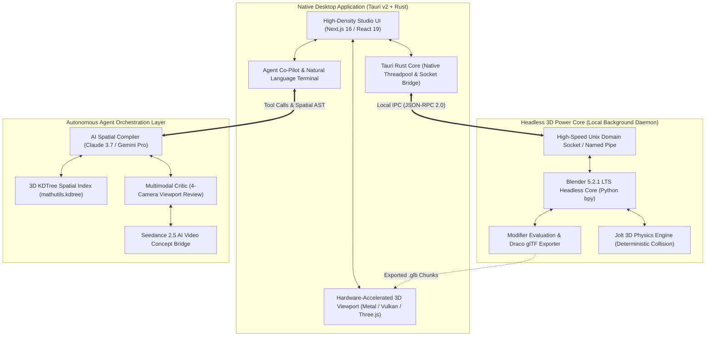

# MomentumStudio AI // Technical System Architecture Specification
**Native Desktop Shell, Headless Engine Daemon & Declarative Spatial AST Schema**

---

## 1. High-Level System Architecture



---

## 2. Declarative Spatial AST Schema (`.world.json`)

Instead of unpredictable python script generation, the agent outputs a **deterministic, version-controlled declarative spatial graph**:

```json
{
  "$schema": "https://momentumstudio.ai/schemas/world-v1.0.json",
  "project_name": "Sector_01_Cerberus_Corridor",
  "version": "1.0.0",
  "units": "meters",
  "splines": [
    {
      "id": "spline_main_track",
      "type": "BEZIER",
      "closed": false,
      "points": [
        {"co": [0.0, 0.0, 0.0], "handle_left": [0.0, 0.0, -10.0], "handle_right": [0.0, 0.0, 10.0]},
        {"co": [0.0, 15.0, 250.0], "handle_left": [0.0, 10.0, 230.0], "handle_right": [0.0, 20.0, 270.0]}
      ],
      "corridor_clearance_radius_m": 32.0,
      "enforce_kdtree_audit": true
    }
  ],
  "procedural_zones": [
    {
      "id": "zone_brutalist_flanks",
      "anchor_spline": "spline_main_track",
      "generator": "PROCEDURAL_MEGATOWERS",
      "parameters": {
        "lateral_offset_m": 38.5,
        "tower_spacing_m": 45.0,
        "height_min_m": 80.0,
        "height_max_m": 160.0,
        "materials": ["MAT_Concrete_Brutalist_01", "MAT_Glass_Reflective_Cyan"]
      }
    }
  ],
  "lighting_budget": {
    "max_pooled_lights": 6,
    "volumetric_fog_density": 0.0145,
    "skybox_energy": 0.65
  },
  "physics_contracts": {
    "engine": "JOLT_3D",
    "collision_layers": ["WORLD_STATIC", "PLAYER_TRACK", "HAZARDS"],
    "max_physics_tick_ms": 4.0
  }
}
```

---

## 3. Local IPC Communication Protocol (JSON-RPC 2.0)

The Tauri Rust desktop host communicates with the headless Blender engine daemon over a local Unix domain socket (`/tmp/momentum_studio_engine.sock` on macOS):

### Request: Compile & Audit Scene Chunk
```json
{
  "jsonrpc": "2.0",
  "id": 1042,
  "method": "engine.compile_world_chunk",
  "params": {
    "world_ast_path": "/Users/deevash/Desktop/MomentumStudio_AI/src/scenes/sector_01.world.json",
    "export_format": "GLTF_DRACO",
    "output_path": "/Users/deevash/Desktop/MomentumStudio_AI/src/build/sector_01.glb",
    "run_kdtree_corridor_audit": true,
    "min_clearance_m": 32.0
  }
}
```

### Response: Verification & Metrics
```json
{
  "jsonrpc": "2.0",
  "id": 1042,
  "result": {
    "status": "PASSED",
    "objects_spawned": 420,
    "kdtree_scanned_objects": 420,
    "obstructions_pruned": 0,
    "clearance_percent": 100.0,
    "execution_time_ms": 142.8,
    "gltf_file_bytes": 1842096,
    "active_pooled_lights": 6
  }
}
```
