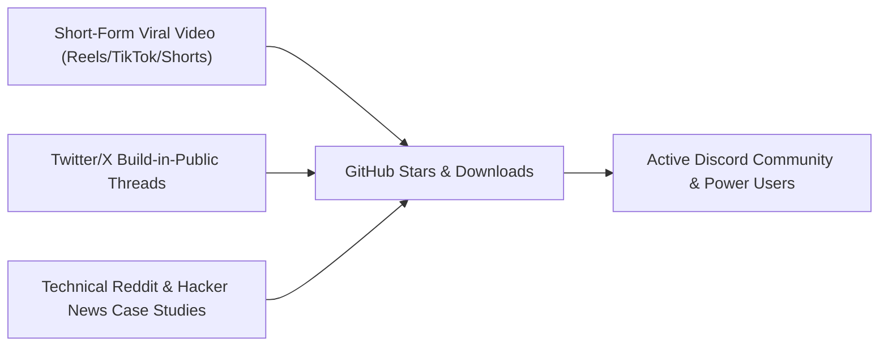

# Master Social Media Launch Strategy: MomentumStudio AI
**Author:** Product Marketing Strategist (@Employee_08)  
**Founder & CEO:** Deevash  
**Target:** Indie Game Devs, Technical Artists, AI Creators, Hacker News, Twitter Tech Community  

---

## 1. Brand Identity & Positioning

- **Tagline:** The Cursor for 3D Game Worlds.
- **Value Proposition:** Stop clicking through 10,000 Blender buttons. Prompt, compile, and mathematically verify continuous 3D game worlds with headless Blender and Godot Jolt physics in sub-seconds.
- **Tone of Voice:** Engineering-first, hyper-competent, anti-bloat, visually hypnotic, transparent, and founder-driven.

### Social Handles to Register:
- **Twitter/X:** `@MomentumStudio3D` or `@MomentumStudioAI`
- **Instagram:** `@momentumstudio.ai` or `@momentumstudio3d`
- **GitHub Repository:** `deevashb24/momentum-studio-ai`
- **Discord Community:** *MomentumStudio AI Creators*

### Bio Copy (Optimized for Conversion):
> **Twitter/X Bio:**  
> The Cursor for 3D Game Worlds ⚡ Declarative spatial AST compiler + headless Blender 5.2.1 + Godot 4.7 Jolt Physics. 100% collision-free. Free & Open Source ⬇️  
> `github.com/deevashb24/momentum-studio-ai`

> **Instagram Bio:**  
> 🎮 The Cursor for 3D Game Worlds  
> ⚡ Replace 10,000 Blender buttons with 1 prompt  
> 🏎️ 900m Jolt Physics verified in 0.6ms  
> 💻 Download Native Mac Desktop App ⬇️  
> `github.com/deevashb24/momentum-studio-ai`

---

## 2. The 3 Growth Engines

1. **Top of Funnel: Visual Dopamine (Instagram Reels / TikTok / YouTube Shorts)**
   - Screen recordings of the dark obsidian Three.js viewport instantly generating 126 modular skyscrapers, neon transit tubes, and rain-soaked asphalt in 300 milliseconds.
2. **Mid Funnel: Technical Credibility (Twitter/X & Hacker News)**
   - In-depth engineering breakdowns: "Why Mixar failed with in-viewport Blender forks", "How we use 3D KDTree bounding box math to guarantee zero car collisions".
3. **Bottom of Funnel: Open Source Virality (Reddit & Discord)**
   - Post to `r/gamedev`, `r/blender`, `r/godot`, `r/IndieDev`: "I built an open source tool that compiles 3D worlds from JSON with headless Blender and Godot Jolt physics".

---

## 3. Launch Checklist for Founder Deevash (Next 15 Minutes)

- [ ] **Step 1:** Create Instagram account (`@momentumstudio.ai`).
- [ ] **Step 2:** Paste the bio copy and set the profile avatar (use `src-tauri/icons/icon.png`).
- [ ] **Step 3:** Record the screen using the 60-Second Video Script (`02_viral_60s_demo_video_script.md`).
- [ ] **Step 4:** Post Video 01 on Instagram Reels and Twitter/X with the launch thread.
